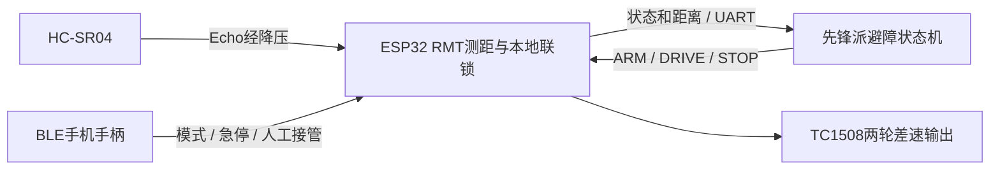

# 先锋派 + ESP32-S3 UART / HC-SR04 避障

> 当前工作副本已继续进行设备烧录及 Wi-Fi 手柄修复。最新入口是 `README_WIFI.md`，当前验证以交付包《网页遥控修复与验证.md》为准。下文“仅离线、未烧录”等描述保留的是最初 UART/测距开发阶段的历史验证范围。

本工程在上一版 BLE 小车工作副本上增加双板通信和避障。此次仅读取资料、修改副本、桌面测试及离线编译；没有打开真实串口、运行电机、修改先锋派系统或烧录任何设备。

先阅读本文，再看 `docs/uart-hcsr04-protocol.md`。先锋派端说明位于 `loongson/README.md`。原 BLE 页面仍为 `phone/index.html`。

## 资料核对与适用板卡

本次审阅六个 ZIP 的目录，重点读取：先锋派 `G2K03Z1_V1.1` 原理图、引脚复用图、用户手册 V2.1、源码编译指南、2K0300芯片资料、Linux设备树和U-Boot先锋派板型定义。没有运行资料中的安装程序或烧录命令。

| 项目 | 已核实资料 | 本工程选择 |
|---|---|---|
| 先锋派外接UART | 原理图PDF第30页 J8-8=TX、J8-10=RX；引脚复用图一致 | 使用 UART2，不占UART0调试 |
| Linux节点 | 用户手册PDF第148页，J8 8/10回环示例 `/dev/ttyS2` | 默认 `/dev/ttyS2`，运行前只读预检 |
| 设备树 | 源码serial2→uart2→0x16100800，先锋派dts启用 | 无需为UART2重编内核 |
| 包内已编译DTB | func2/pi_hat两个DTB均启用串口0x16100800，stdout=serial0 | 源码与已提供DTB交叉核对通过；板上实际DTB仍需预检 |
| 用户手册差异 | PDF第35页的J9表属于不同扩展板布局 | 不按该J9表给先锋派接线 |
| 系统与工具链 | 编译指南Ubuntu22.04/24.04、GCC13.3 ABI2 | 本任务不改内核/U-Boot；主机用Python标准库，不要求交叉编译新二进制 |

原理图中的 J8 是2×20、2.54mm排针；图中的“8/10”是物理针脚编号，不是龙芯GPIO编号。UART2的复用GPIO为44/45，也不要当作ESP32 GPIO44/45。以板上第1脚标记定位，不能只按照片的左右方向数针。

## 接线

| 先锋派 / 模块端 | ESP32端 | 说明 |
|---|---|---|
| 先锋派 J8-8，UART2_TX | GPIO9，UART1_RX | 3.3V TTL |
| 先锋派 J8-10，UART2_RX | GPIO8，UART1_TX | TX/RX交叉 |
| 先锋派 J8-6 或 J8-9，GND | GND | 双板共地 |
| HC-SR04 TRIG | GPIO10 | 10us高电平触发 |
| HC-SR04 ECHO | 经分压/电平转换后到GPIO11 | 禁止5V Echo直入ESP32 |
| HC-SR04 GND | GND | 与两板共地 |
| HC-SR04 VCC | 稳定5V电源 | 不接3.3V；不接未知电机电池原始电压 |

ESP32 GPIO8/9沿用前一版预留；GPIO10/11在选中小车板配置中未分配，是本次候选。ESP32开发板/扩展板的实物引出、隐藏占用与丝印尚未核验，可在 `Car BLE 360 control` 中交换同组引脚，编译期禁止TRIG/ECHO相同或与UART重叠。原电机 GPIO12/13/14/21、I2S和OLED引脚不变。

Echo分压建议：HC ECHO → **2.2kΩ** → ESP GPIO11；GPIO11 → **3.3kΩ** → GND，建议1%电阻。理想5V输入得到3.0V，属于3.3V数字输入的有效高电平；实际波形与电源仍需测量。也可用合适的单向5V→3.3V转换器。HC模块克隆版的TRIG阈值需实测，若3.3V TRIG不能可靠触发，应增加合适的3.3V→5V缓冲器。

两板分别按原要求供电，只交叉UART并共地，不直接互接两块板的5V/3.3V正极。UART不是RS232接口。HC-SR04只提供前向信息，因此软件不自动倒车，也不宣称能识别侧后方障碍、台阶或软质吸声物。

## 程序分工



ESP32以不短于80ms周期触发传感器，RMT以1MHz分辨率测Echo。采用25ms接收空闲阈值、60ms软件超时；无回波、异常多脉冲、超范围都标无效，不把“没测到”当作无障碍。室温声速近似343m/s，距离按 `echo_us×343/2000` 取最近整数毫米，接受20..4000mm。

滤波最多保留3个有效测量，中值只抑制远端跳变；新出现的近障距离立即采用，不能被旧的远距离掩盖。发生无效测量会清滤波历史。

自动模式下，ESP32每10ms检查：采样无效或年龄超过180ms时停车并取消使能；≤300mm禁止继续前进，允许受限原地转向；≤120mm禁止所有自动运动。解除限制后不会自行恢复旧运动，必须有新的有效DRIVE。该联锁不覆盖手机手动模式，便于人工接管。

先锋派执行：

1. 手机先连接并选择“龙芯自动”。先锋派端需看到同一会话连续3个新的有效距离样本，再发送ARM并等待新的已使能状态确认。
2. 前方>450mm，30%上限前进；300..450mm，20%慢行。
3. 前方≤300mm先保持零输出160ms，再以25%原地转向。转向至少200ms且连续3个新样本>450mm，才停车稳定160ms并恢复前进。
4. 转向800ms仍未确认清路、距离≤120mm、传感器无效/过期、串口CRC/时效错误、手机急停/断连/模式切换，立即终止本轮。软件不会自动重新使能；人工排查后重新选择自动模式并重新运行。

这些阈值、PWM占空比和时长是初始工程配置，不是已标定的车速、转角或制动距离。默认右转，可用主机参数选择左转。单传感器方案无法保证任意复杂环境都能绕行。

## 先锋派程序使用（本次没有对实物执行）

使用板上Python3.9或更新版本，程序不依赖pyserial。将整个 `loongson/` 目录复制到先锋派任意工作目录（保持 `car_uart.py` 与 `avoidance_uart.py` 相邻）。先运行只读预检：

```text
python3 avoidance_uart.py --preflight --port /dev/ttyS2
```

预检核对字符设备、控制台/getty占用、设备树serial2和sysfs地址0x16100800，不会修改设备树、关闭服务或打开UART。未验证身份或被占用时拒绝运动；不要为了通过检查盲目停用系统服务。

默认只监视状态和距离，不发送控制命令：

```text
python3 avoidance_uart.py --port /dev/ttyS2
```

未来确认接线、模块波形及停车能力后，手机先切自动模式，再运行：

```text
python3 avoidance_uart.py --port /dev/ttyS2 --enable-motion --wiring-confirmed
```

两个开关都必须明确给出。启动时若已处于使能状态，会拒绝接管，要求人工重新选择自动模式。手机必须保持连接；Ctrl+C尽力发送当前会话STOP，若通信不可用，由ESP32的180ms传感器联锁/300ms命令watchdog停车。`car_uart.py` 是前版兼容工具，新避障功能请使用 `avoidance_uart.py`。

## 构建与测试

本次工程 `sdkconfig` 和 `sdkconfig.defaults` 已启用UART1和HC-SR04，开机仍停车。手机BLE协议不变。ESP-IDF 5.5.4开发终端，在本目录运行：

```text
idf.py -D CMAKE_NINJA_FORCE_RESPONSE_FILE=ON -B build build
```

不需要更新先锋派内核、U-Boot或驱动。本机没有可用Linux运行环境和已验证的LoongArch交叉工具链，因此不伪造内核/LoongArch本机运行结果；Python纯逻辑/协议在电脑验证，Linux真实termios/串口尚未执行。

桌面测试：C++17编译 `tests/car_core_test.cpp`、`tests/range_test.cpp`；HTTP检查需cJSON；Node运行 `tests/phone_test.cjs`；Python运行 `python -m unittest discover -s tests -p "test_*.py" -v`。`tests/firmware_simulator.cpp` 可编译成PC可执行程序，设置环境变量 `CAR_FIRMWARE_SIMULATOR` 为其绝对路径后，Python将测试真实C++控制核心与真实Python避障程序的字节流交互；Echo输入仍为模拟。未构建模拟器时该部分会明确SKIP，不代表通过。

## 烧录前与上板后边界

已做的软件准备见交付测试记录：资料与二进制DTB核对、协议与代码、错误/超时回归、完整目标编译、镜像校验、工程包校验。

仍需人工在接线/上板阶段完成：确认两块实物板版本、J8方向与ESP32引出；HC供电/分压/波形；串口回环、实际Linux节点、引脚复用与占用；传感器真实距离、盲区/噪声/无回波；架空轮子核对电机极性与急停；测量实际速度、转向角、停距并调整阈值；负载下Wi-Fi/BLE/音频与RMT共存。未完成这些检查前，不把桌面通过当成实车验收。

本工程没有自动烧录、自动安装或自动开机运动服务。
